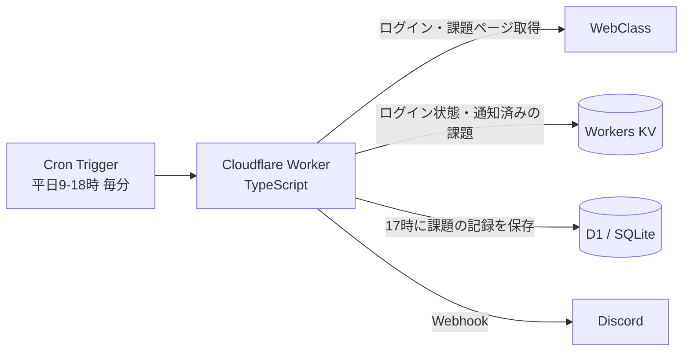

# WebClass 課題通知ボット

大学の学習システム（WebClass）を自動で見に行き、**未提出の課題を Discord に知らせる**ボットです。
2025年5月から個人で開発し、今も毎日使っています。

## つくった理由
課題の締切を WebClass で毎回確認するのが面倒で、出し忘れそうになったことがきっかけです。
いつも見ている Discord に通知が来れば、確認しに行かなくても締切に気づけると考えました。

## できること
| タイミング | 通知の内容 |
|---|---|
| 平日 9:00〜17:59 に毎分チェック | 締切が **3日以内** の未提出課題が**新しく見つかったら**すぐ通知（同じ課題は二度通知しない） |
| 平日 17:00 | 未提出の課題を**締切日ごとにまとめて**通知（締切なしの課題も最後にまとめる） |

通知の例：
```
未提出の課題 3 件（10/29(木) 17:00 時点）
■ 10/30(金)
・09:00まで【レポート】第5回レポート（プログラミング演習）
■ 10/31(土)
・23:59まで【小テスト】確認テスト（情報数学）
■ 締切なし
・【アンケート】授業アンケート（情報数学）
```

## 仕組み

- **サーバーを用意しなくていい** Cloudflare Workers を選び、Cron Trigger で決まった時間に動かしています（無料枠内）。
- WebClass に API はないので、**ログインして HTML を読み取って**課題を取り出しています。

## 改良の流れ
1. **最初は「未読の印がつくたびに通知」** → 課題と関係ない「お知らせ」まで届き、通知が多すぎて見なくなってしまった
2. **課題（レポート・小テスト・アンケート）だけに絞り**、「欠席連絡」のような課題でないものは除外
3. **締切日ごとにまとめて、平日17時に1回**送る形に変更（授業が終わったあとに見られる時間）
4. 急ぎの課題は待たずに知らせたいので、**締切3日以内の課題は見つけた時点で通知**し、同じ課題を何度も送らないようにした
5. 課題の記録を D1 に残すようにした（いつ見つけて、いつ提出したか）

## 工夫したところ
- **二重通知の防止**：通知した課題を KV に覚えておき、新しいものだけ送る。ID に締切日時を含めているので、締切が延びたときは改めて通知される。締切が過ぎたものは自動で消して、データが増え続けないようにした。
- **WebClass に負担をかけない**：全コースを見るのは30分に1回だけ。それ以外の毎分のチェックは、トップページに「締切が近い課題があります」と出ているコースだけを見る。ログイン状態も6時間使い回し、毎回ログインしない。
- **パスワードをコードに書かない**：WebClass の ID・パスワードと Discord の URL は、Cloudflare の「秘密の設定（Secrets）」に入れている。
- **外から勝手に動かされない**：以前は URL を開くと手動でチェック・テスト通知ができたが、誰でもログインや通知を動かせてしまうため廃止した。今は URL にアクセスしても何も起きない。
- **メンションの誤爆を防ぐ**：課題名に `@everyone` などが入っていても、Discord で全員に通知が飛ばないようにしている。

## 苦労したところ
- **ログインがうまくいかなかった**：ログイン後のリダイレクト先が、HTTP のヘッダーではなく **JavaScript の中に `\/` のような記号つきで**書かれていて、そのままではページを移動できなかった。レスポンスの中身を1つずつ見て原因を突き止め、記号を直してから移動するようにした。
- **リダイレクトの途中で配られる Cookie**：自動でリダイレクトをたどると途中の Cookie が取れず、ログインが保てなかった。リダイレクトを自分で1つずつたどり、Cookie を集めるようにした。
- **時間帯のずれ**：Cloudflare の Cron は UTC で動くので、日本時間の 9〜18時は `* 0-8 * * MON-FRI` になる。日付や「17時のまとめ」も、日本時間で数えるように気をつけた。

## 使った技術
| 種類 | 技術 |
|---|---|
| 言語 | TypeScript |
| 実行環境 | Cloudflare Workers（Cron Trigger） |
| データ | Workers KV（ログイン状態・通知済み）、D1（課題の記録・SQLite） |
| 通知 | Discord Webhook |
| テスト | `node:test` |
| デプロイ | Wrangler |

## ファイル構成
```
├ src/
│  ├ index.ts        … 本体。ログイン・課題の取得・通知・Cron の入口
│  ├ assignments.ts  … HTML からコースと課題を取り出す／締切が近いものを選ぶ
│  ├ summary.ts      … 17時のまとめ通知の文章をつくる
│  └ history.ts      … 課題の記録を D1 に保存する
├ test/              … 自動テスト（通信しない部分）
├ schema.sql         … D1 のテーブル定義
└ wrangler.toml      … Cloudflare の設定（Cron・KV・D1）
```

## 動かし方
```
npm install
npm test                                   # テスト
npx wrangler kv namespace create STATE     # 出てきた id を wrangler.toml に書く
npx wrangler d1 create webclass-notifier   # 出てきた id を wrangler.toml に書く
npx wrangler d1 execute webclass-notifier --remote --file=schema.sql
npx wrangler secret put WEBCLASS_USERNAME
npx wrangler secret put WEBCLASS_PASSWORD
npx wrangler secret put DISCORD_WEBHOOK
npm run deploy
```
動作の確認は `npm run logs`（`wrangler tail`）でログを見ます。

## 注意
- 自分のアカウントで、自分の課題を確認するためだけに使っています。
- 同じ大学の WebClass 以外では、HTML の形が違うため動きません。
